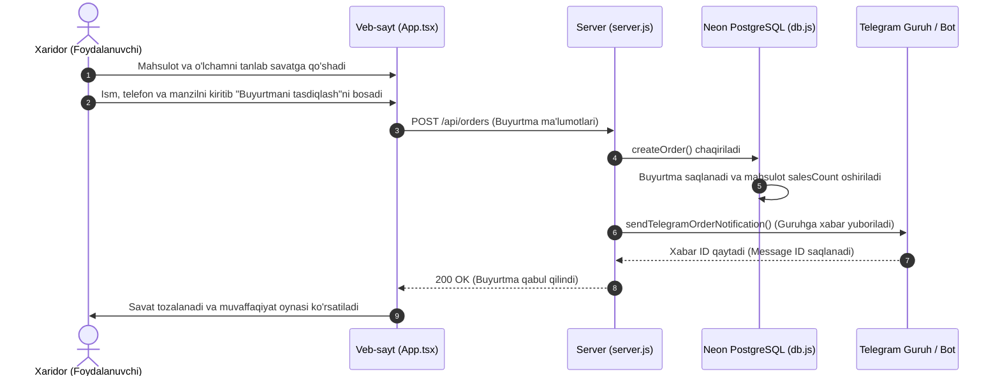
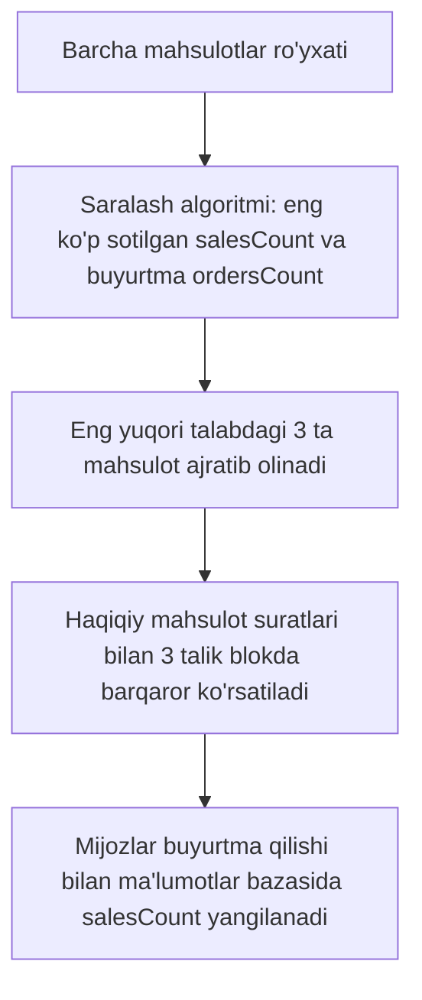

# UNIVERSAL CLOTHING STORE PLATFORM — To'liq Loyiha Texnik Auditi va Funksiyalar Xaritasi

> **Hujjat turi:** Texnik arxitektura va funksiyalar auditi  
> **Loyiha nomi:** Universal Kiyim-Kechak E-Tijorat Tizimi (Telegram WebApp & Forum Integratsiyasi)  
> **Dastur turi:** Full-stack veb-ilova (SPA + REST API + PostgreSQL + Telegram WebApp + Yagona Telegram Bot)

---

## 1. Loyihaning Umumiy Arxitekturasi

Platforma uchta asosiy qismdan tashkil topgan:
1. **Frontend (Foydalanuvchi interfeysi):** React 19, TypeScript, Vite, Tailwind CSS, Framer Motion (`motion/react`), Lucide Icons. Telegram WebApp ichida ham, mustaqil veb-brauzerda ham birdek moslashuvchan (responsive) ishlaydi.
2. **Backend & API qatlami:** Node.js HTTP serveri (`server.js`), Vercel serverless funksiyalari (`api/index.js`), RESTful API endpointlari.
3. **Ma'lumotlar ombori va Saqlash (Database & Storage):** Neon Serverless PostgreSQL (bulutli relyatsion MB), tezkor in-memory kesh, mahalliy zaxira fayllar (`products.json`, `orders.json`, `banners.json`), Cloudinary va mahalliy tasvirlar bazasi.
4. **Telegram Ekotizimi:** Mijozlar uchun Telegram WebApp integratsiyasi, buyurtmalar kelib tushadigan guruh/kanal notifikatsiyalari va admin bot (`bot.js`).
5. **Admin Paneli (`public/admin.html`):** Boshqaruv statistikasi, mahsulotlar (CRUD + Ommaboplik), buyurtmalar holati, hisobotlar, faollar/guruhlar, bannyerlar va aloqa sozlamalari.

```
                    ┌──────────────────────────────────────────────┐
                    │               FOYDALANUVCHILAR               │
                    │   (Brauzer / Mobil / Telegram WebApp)        │
                    └──────────────────────┬───────────────────────┘
                                           │
                                           ▼
                    ┌──────────────────────────────────────────────┐
                    │            FRONTEND (React 19 SPA)           │
                    │  App.tsx, ProductGallery, Sheet, Logo        │
                    └──────────────────────┬───────────────────────┘
                                           │ HTTP REST API
                                           ▼
                    ┌──────────────────────────────────────────────┐
                    │         NODE.JS SERVER / VERCEL API          │
                    │  server.js (port 3000) / api/index.js        │
                    └──────────────┬────────────────┬──────────────┘
                                   │                │
            Ma'lumotlar oqimi      │                │  Bildirishnomalar
                                   ▼                ▼
┌──────────────────────────────────────────┐   ┌─────────────────────────────┐
│          DATABASE LAYER (db.js)          │   │      TELEGRAM EKOTIZIMI     │
│  - Neon Serverless PostgreSQL            │   │  - Yagona Bot (Admin & User)│
│  - In-Memory Cache (TTL)                 │   │  - Buyurtmalar guruhi/kanali│
│  - Fallback JSON (products/orders)       │   │  - Inline WebApp klaviatura │
└──────────────────────────────────────────┘   └─────────────────────────────┘
```

---

## 2. Asosiy Fayllar va Ularning Vazifalari

### 2.1. Frontend Qatlami

| Fayl | Joylashuvi | Asosiy Vazifasi | Qaysi komponentlar bilan ishlaydi |
| :--- | :--- | :--- | :--- |
| **`src/App.tsx`** | Frontend markazi | Barcha sahifa holatlari (State), navigatsiya, qidiruv, saralash, savat, sevimlilar, buyurtma berish, autentifikatsiya va to'plamlar rotatsiyasini boshqaradi. | `ProductCard`, `ProductGallery`, `Sheet`, `Logo`, `telegram.ts`, `demoData.ts` |
| **`src/components/ProductCard.tsx`** | Komponent | Mahsulot kartochkasi: surat hover effekti, yangi/chegirma nishoni, sevimli (wishlist) tugmasi, narx formati va savatga tezkor qo'shish. | `App.tsx`, `data.ts`, `lucide-react` |
| **`src/components/ProductGallery.tsx`** | Komponent | Mahsulotning ko'p suratlari slayderi, miniatyuralar (thumbnails), surish (swipe) va kattalashtirish (zoom lightbox) darchasi. | `App.tsx`, `motion/react` |
| **`src/components/Sheet.tsx`** | Komponent | Pastdan yoki yondan chiquvchi modal darcha (Bottom Sheet / Drawer). Drag-to-dismiss va fon xiralashtirish funksiyasi. | `App.tsx`, `motion/react` |
| **`src/components/Logo.tsx`** | Komponent | Brendning hashamatli vektorli SVG logotipi, o'lchamlari va sahifa boshiga o'tkazuvchi havolasi. | `App.tsx` |
| **`src/telegram.ts`** | Yordamchi modul | Telegram WebApp SDK wrapper: haptic tebranish (`haptic.impact()`, `haptic.notification()`), foydalanuvchi ma'lumotlarini olish. | `App.tsx`, `window.Telegram.WebApp` |
| **`src/demoData.ts`** | Zaxira ma'lumot | Server yoki tarmoq uzilganda do'kon bo'shab qolmasligi uchun 12+ ta to'liq kiyim to'plamlari bilan ta'minlovchi lokal baza. | `App.tsx` |
| **`src/data.ts`** | Konstantalar | Kategoriyalar ro'yxati, o'lchamlar (`XS` dan `XXL` gacha), `money()` narx formatlash yordamchisi. | `App.tsx`, `ProductCard.tsx` |
| **`src/index.css`** | Stillar arxitekturasi | Tailwind bazasi, custom shriftlar (HASBOOK, Inter), kartochkalar, to'plamlar slayderi va mobil optimizatsiyalar. | Butun frontend interfeysi |

---

### 2.2. Backend va Server Qatlami

| Fayl | Joylashuvi | Asosiy Vazifasi | Qaysi modullar bilan bog'langan |
| :--- | :--- | :--- | :--- |
| **`server.js`** | Ilova serveri | Asosiy HTTP server (Port 3000): API marshrutizatsiyasi (routing), CORS boshqaruvi, statik fayllarni uzatish, Telegram xabarlarini yuborish/o'chirish. | `db.js`, `public/*`, `dist/*` |
| **`api/index.js`** | Vercel Serverless | Vercel hostingida barcha API so'rovlarni qabul qilib, serverless ko'rinishda javob beruvchi yagona kirish nuqtasi. | `db.js` |
| **`db.js`** | Ma'lumotlar ombori yadrosi | Neon PostgreSQL (`@neondatabase/serverless`) ulanishi, kesh boshqaruvi, jadval sxemalari, CRUD operatsiyalari va lokal fayl fallback tizimi. | `server.js`, `api/index.js`, `bot.js` |
| **`bot.js`** | Telegram Bot dvigateli | Admin va Mijoz botlari uchun long-polling/webhook mantig'i: yangi buyurtmalarni guruhga jo'natish, bot orqali mahsulot qo'shish va admin buyruqlari. | `db.js`, `bot-config.json` |

---

### 2.3. Ma'muriyat va Boshqaruv (Admin)

| Fayl | Joylashuvi | Asosiy Vazifasi | Qaysi API endpointlar bilan ishlaydi |
| :--- | :--- | :--- | :--- |
| **`public/admin.html`** | Admin paneli SPA | Butun do'kon boshqaruvi: Boshqaruv (Dashboard), Mahsulotlar jadvali (1-click Ommaboplik, narx, zaxira), Buyurtmalar holati, Hisobotlar, Faollar, Bannyerlar va Manzillar. | `/api/products`, `/api/orders`, `/api/banners`, `/api/admin/*`, `/api/contacts` |

---

## 3. Asosiy Funksiyalar va Ularning O'zaro Bog'liqlik Xaritasi

Quyidagi jadvalda tizimda mavjud bo'lgan asosiy funksiyalar, ularning qaysi faylda joylashganligi, vazifasi va nimalar bilan hamkorlikda ishlashi to'liq keltirilgan:

### 3.1. Mahsulotlar va Katalog Boshqaruvi

| Funksiya Nomi | Fayl | Vazifasi | Bog'langan Tizimlar / Funksiyalar |
| :--- | :--- | :--- | :--- |
| **`getProducts()`** | `db.js` | Barcha mahsulotlarni Neon PostgreSQL-dan oladi. Agar keshda bo'lsa, tezkor xotiradan qaytaradi. Baza ishlamasa `products.json` yoki `demoData`ga tayanadi. | `server.js`, `api/index.js`, `App.tsx` |
| **`createProduct(prod)`** | `db.js` | Yangi mahsulotni ma'lumotlar bazasiga yozadi, rasmlarni normallashtiradi, keshni tozalaydi (`invalidateProductsCache`). | `public/admin.html`, `server.js`, Telegram Bot |
| **`updateProduct(id, updates)`** | `db.js` | Mahsulot narxi, o'lchamlari, matnlari yoki "Ommabop" (`isPopular`) maqomini yangilaydi. | `public/admin.html`, `server.js` (`PUT /api/products/:id`) |
| **`deleteProduct(id)`** | `db.js` | Mahsulotni bazadan va zaxira fayllardan o'chiradi. Agar Telegram kanalga joylangan bo'lsa, xabarni ham o'chiradi. | `server.js` (`deleteTelegramMessages`), `admin.html` |
| **`togglePopular(id)`** | `public/admin.html` | Bitta bosish orqali mahsulotni "Ommabop to'plamlar"ga kiritadi yoki chiqaradi (`PUT /api/products/:id`). | `updateProduct()`, `App.tsx`dagi Top-3 algoritmi |
| **`popularTopProducts`** | `src/App.tsx` | Bazadagi eng ko'p sotilgan (`salesCount`) va buyurtma tushgan (`ordersCount`) barqaror Top-3 mahsulotni saralaydi. | `productsList`, `hot-sale-grid` |
| **`dynamicCategories`** | `src/App.tsx` | Bazadagi barcha mahsulotlar toifalarini avtomatik aniqlaydi (masalan, "Kardigan", "Sviter" qo'shilsa yangi bo'lim ochiladi). | `catalog-chips-row`, `ProductCard` |
| **`randomizedProductsList`** | `src/App.tsx` | "Barchasi" tanlanganda do'kondagi turli toifadagi to'plamlarni jozibador aralash (random shuffle) tartibda ko'rsatadi. | `catalogProducts`, `filterAndSort` |
| **`renderCategoryIcon()`** | `src/App.tsx` | Emojilar o'rniga zamonaviy premium Lucide vektor SVG ikonlarini toifalarga moslab render qiladi (`Sparkles`, `Shirt`, `Layers`, `Crown`, `Feather`, `Flame`, `Tag`). | `catalog-chips-row` |
| **`openProduct(prod)`** | `src/App.tsx` | Mahsulot batafsil oynasini ochadi, rasmlar galereyasini tayyorlaydi va tegishli o'lchamlarni tanlashga uzatadi. | `ProductGallery`, `Sheet`, `activeProduct` |

---

### 3.2. Savat, Sevimlilar va Xarid Jarayoni (Checkout)

| Funksiya Nomi | Fayl | Vazifasi | Bog'langan Tizimlar / Funksiyalar |
| :--- | :--- | :--- | :--- |
| **`addToCart(id, size, qty)`** | `src/App.tsx` | Mahsulotni tanlangan o'lcham va miqdor bilan savatga qo'shadi, `localStorage`ga yozadi va tebranish beradi. | `haptic.impact()`, `cart` state, `CartDrawer` |
| **`updateCartQuantity(id, size, delta)`**| `src/App.tsx` | Savatdagi mahsulot sonini oshiradi, kamaytiradi yoki 0 bo'lsa o'chiradi. | `cart` state, narxlar qayta hisobi |
| **`toggleFavorite(id)`** | `src/App.tsx` | Mahsulotni sevimlilar (wishlist) ro'yxatiga qo'shadi yoki olib tashlaydi, `localStorage` bilan sinxronlaydi. | `favorites` state, `ProductCard`, `WishlistDrawer` |
| **`createOrder(order)`** | `db.js` | Yangi buyurtmani bazaga yozadi, xarid qilingan mahsulotlarning `salesCount` va `ordersCount` ko'rsatkichlarini avtomatik oshiradi. | `server.js` (`POST /api/orders`), PostgreSQL |
| **`submitOrder()`** | `src/App.tsx` | Savatdagi mahsulotlar va xaridor anketasini yig'ib `POST /api/orders`ga jo'natadi, savatni tozalaydi va muvaffaqiyat bildirishnomasini ko'rsatadi. | `createOrder()`, Telegram Bot bildirishnomalari |
| **`updateOrderStatus()`** | `public/admin.html` | Buyurtma holatini "Kutilmoqda", "Qabul qilindi", "Yetkazildi" yoki "Bekor qilindi"ga o'zgartiradi. | `PUT /api/orders/:id`, `db.js` |

---

### 3.3. Foydalanuvchi Profili va Autentifikatsiya

| Funksiya Nomi | Fayl | Vazifasi | Bog'langan Tizimlar / Funksiyalar |
| :--- | :--- | :--- | :--- |
| **`getTelegramWebApp()`** | `src/telegram.ts` | Telegram WebApp muhitini aniqlaydi (`window.Telegram.WebApp`). | Telegram messenjeri, `App.tsx` |
| **`initTelegramUser()`** | `src/App.tsx` | Foydalanuvchi Telegram orqali kirganida uning ismi va ma'lumotlarini profili bilan avtomatik bog'laydi. | `telegram.ts`, `profile` state |
| **`saveProfile()`** | `src/App.tsx` | Foydalanuvchining ismi, telefon raqami va parolini `localStorage`da xavfsiz saqlaydi, savatda avtomatik to'ldiriladi. | `ProfileDrawer`, `CartDrawer` |

---

### 3.4. Telegram Bildirishnomalari va Guruh Boshqaruvi

| Funksiya Nomi | Fayl | Vazifasi | Bog'langan Tizimlar / Funksiyalar |
| :--- | :--- | :--- | :--- |
| **`sendTelegramOrderNotification()`** | `server.js` / `bot.js` | Sayt yoki WebApp-dan buyurtma tushganda belgilangan Telegram guruhi/kanaliga chiroyli formatlangan hisobot yuboradi. | Telegram Bot API (`sendMessage`), Buyurtmalar guruhi |
| **`saveTelegramGroup()`** | `db.js` | Bot qo'shilgan yangi guruh yoki kanallarni ro'yxatga oladi. | `admin.html` (Faollar bo'limi), Telegram Bot |
| **`setTargetTelegramGroup()`**| `db.js` | Buyurtmalar aynan qaysi guruh yoki kanalga borishi kerakligini belgilaydi. | `admin.html`, `server.js` |
| **`isValidAdminKey()`** | `db.js` | Telegram orqali admin botga kirayotgan xodimlarning maxfiy kalitini tekshiradi. | `bot.js`, `admin_keys` jadvali |

---

## 4. Muhim Biznes Jarayonlari (Ma'lumotlar Oqimi)

### 4.1. Buyurtma berish jarayoni (End-to-End Flow)



---

### 4.2. Ommabop To'plamlar (Hot Sale — Top 3 Best Sellers) Jarayoni



---

## 5. Xavfsizlik, Unumdorlik va Kesh Auditi

1. **In-Memory Kesh Mexanizmi (`db.js`):**
   - Mahsulotlar ro'yxati xotirada saqlanadi (`productsCache`).
   - Har bir yangilanish, o'chirish yoki yangi mahsulot qo'shilganda `invalidateProductsCache()` funksiyasi keshni darhol tozalaydi va yangi so'rovlar yangi ma'lumotni bazadan oladi.
   - Bu server yuklamasini kamaytirib, saytning yuklanish tezligini oshiradi.

2. **Ko'p qatlamli zaxira (Fault-Tolerance):**
   - Agar tashqi Neon PostgreSQL serverida uzilish bo'lsa, tizim avtomatik ravishda `products.json` va `demoData.ts`ga ulanadi — do'kon hech qachon "oq ekran" bo'lib qolmaydi.

3. **Telegram WebApp Haptic & UI Moslashuvi:**
   - Sayt mobil qurilmalarda Telegram ichida ochilganda mahalliy ilova (native app) kabi tebranishlar va `viewport` balandligiga moslashadi.
   - Savat va Sevimlilar modal oynalari qulay surish (`touch-drag-to-dismiss`) bilan yopiladi.

---

## 6. Loyiha Xulosasi va So'nggi O'zgarishlar

Platforma to'liq tayyor, barcha funksiyalari o'zaro uzviy bog'langan va barqaror ishlamoqda:
- ✅ **Barcha rasmlar:** Haqiqiy mahsulot rasmlaridan dinamik olinadi (eski lokal suratlardan voz kechildi).
- ✅ **Ommabop to'plamlar (Hot Sale):** Eng ko'p sotilgan va buyurtma tushgan barqaror Top-3 mahsulot xaridorlarga doimiy ko'rinadi (avto-aylanish va ortiqcha knopkalarsiz).
- ✅ **Katalog Mobil UI:** Zamonaviy "Explore Fashion" qidiruv kapsulasi, doiraviy filtr tugmasi va kategoriyalar qatori.
- ✅ **Dinamik toifalar va Random ko'rinish:** Bazaga yangi toifa (masalan, Kardigan, Sviter) qo'shilganda avtomatik bo'lim ochiladi; "Barchasi"da to'plamlar aralash (random) taqdim etiladi.
- ✅ **Vektor SVG Ikonlar:** Emojilar o'rniga toza zamonaviy minimalist SVG vektor ikonkalari o'rnatildi.
- ✅ **Telegram Launch Moslashuvi:** Profil bo'limiga kirilganda Telegram `MainButton` avtomatik yashirilib, ortiqcha ziddiyatli tugmalar ko'rsatilmaydi.
- ✅ **Admin paneli:** Mahsulotlarni tezkor boshqarish (1-click Ommaboplik), buyurtmalarni kuzatish va hisobotlarni tahlil qilish uchun qulay vosita.
- ✅ **Telegram integratsiyasi:** Buyurtmalar zudlik bilan operatorlar guruhiga yetib boradi.

